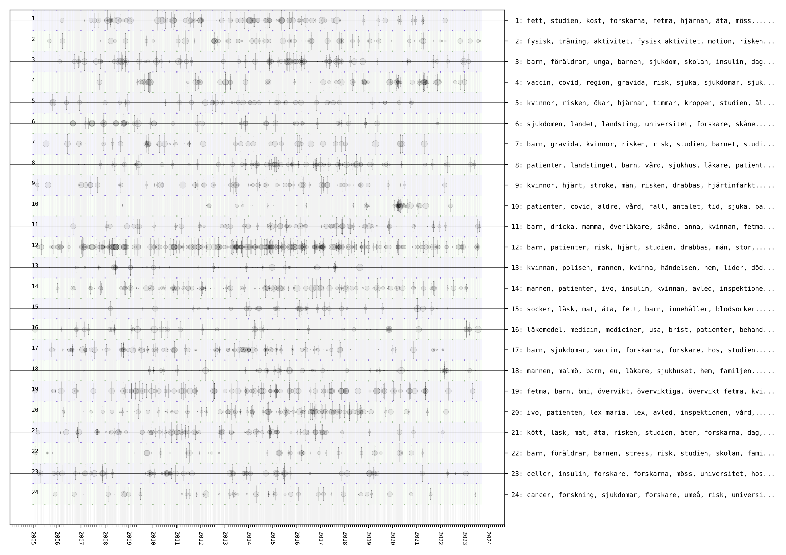
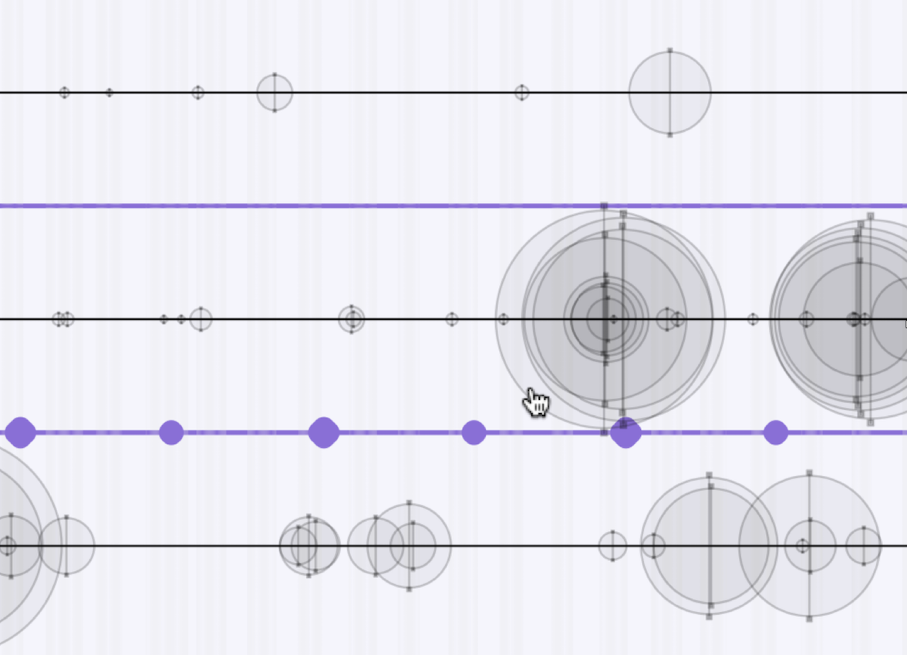

Topic Timelines
===============
This timeline visualises the prevalence of topics over time in a temporally extended corpus, as well as the prominence of the topics in the texts. 

The following examplifies the timeline visualisation for a corpus consisting of Swedish news about diabetes. The y-axis shows 24 topics that have been automatically extracted from the corpus and the x-axis shows the date associated with the texts in the corpus. Each text is represented by a vertical line. The circles represent the level of association between the topic and the text. The larger the circle, the closer the association. Many overlapping circles at a certain date indicates that many texts on this topic were published this date. 

It is possible to associate a unique hyperlink with each text that has been used for generating the timeline. The circles then become clickable links, which direct you to the web page associated with the text, for instance a web page that contains the text with its original layout. It is thereby possible to use the visualisation as a tool for locating and selecting potentially interesting texts for close reading.

Here is a demo page of a: [clickable timeline](https://wordrain.org/static/topic-timelines/wikipedia_2026_popup.html). 

Clustering using SentenceTransformers
-------------------------------------
The topics can be produced by clustering texts encoded with sentence transformers. See [cluster_transformers.py](cluster_transformers.py), and (for an example use case) [cluster_wikipedia.py](cluster_wikipedia.py).

Constructing the timeline
-------------------------------------
The timelines are constructed by running [plot_timeline_from_files.py](plot_timeline_from_files.py). See 
    [timeline_wikipedia.py](timeline_wikipedia.py) and [timeline_diabetes.py](timeline_diabetes.py) for examples.

timeline_wikipedia.py

Topics2Themes
-------------
It is also possible to create the input to the visualisation, based on the output from the topic modelling tool Topics2Themes. You do this by running the following script. 

The Topics2Themes tool automatically extracts topics from a text corpus. You can find the tool at: [https://github.com/mariask2/topics2themes](https://github.com/mariask2/topics2themes)

An example of how to run the code (and what is needed for configuring the Topics2Themes tool in order to be able to create timelines) is given in:  . 

Dependencies
-------------

See requirements

Acknowledgements
----------------
The work on topic-timelines has mainly been conducted within the project ActDisease, partly with support from the research infrastructures Huminfra and InfraVis.

- [ActDisease](https://www.actdisease.org): Acting out Disease: How Patient Organizations Shaped Modern Medicine: ERC Starting Grant (ERC-2021-STG 101040999)
- [Huminfra](https://www.huminfra.se): National infrastructure for Research in the Humanities and Social Sciences (Swedish Research Council, 2021-00176)
- [InfraVis](https://infravis.se): the Swedish National Research Infrastructure for Data Visualization (Swedish Research Council, 2021-00181)
